<!-- Header -->

  

  

  
  
  

---

### About me

I'm an Industrial Engineering student at **Sabancı University**, working where data meets operations. I like problems where a good forecast turns into a better decision: how much to stock, when to reorder, where the money actually sits.

<table>
  <tr>
    <td width="50%" valign="top">
      <h4>📊 Machine Learning Intern · Microsoft</h4>
      Co-developed <b>DemandStockInsight</b>: a forecasting-driven inventory policy that holds <b>~28% less stock</b> while staying near a <b>95% service level</b>.
    </td>
    <td width="50%" valign="top">
      <h4>⚙️ After Sales Value Chain Intern · Toyota</h4>
      Pitched an accessory concept that was <b>approved into the after-sales portfolio</b> and benchmarked 13 competitors.
    </td>
  </tr>
  <tr>
    <td width="50%" valign="top">
      <h4>📄 Publication</h4>
      <i>Measuring ECON–ESG interdependencies</i>, <b>The Engineering Economist</b> (2026). <a href="https://doi.org/10.1080/0013791X.2026.2741058">Read →</a>
    </td>
    <td width="50%" valign="top">
      <h4>🎮 Side project</h4>
      Co-developing a <b>mobile 1v1 fighting game</b>: hand-drawn characters → AI-to-3D → Blender.
    </td>
  </tr>
</table>

---

### Featured project

  

  
  
  
  

XGBoost forecasts → safety stock, reorder points, EOQ, ABC-XYZ and newsvendor → stock policy, with an Azure OpenAI assistant on top.

---

### Toolbox

  
  
  
  
  
  
   
  
  
  
  
  

<b>Methods:</b> demand forecasting · ABC / EOQ / reorder point / safety stock · newsvendor · linear programming · hypothesis testing · simulation

---

  🇹🇷 Turkish (native) &nbsp;·&nbsp; 🇬🇧 English (advanced) &nbsp;·&nbsp; 🇪🇸 Spanish (beginner, learning!)

<!-- Footer -->

  

